# paperclip-esp-alert

A desk companion for [Paperclip](https://github.com/paperclipai/paperclip). It's a small ESP32-S3 box with a touch screen, a speaker and lights. When one of your agents needs an approval, asks you a question, or a run fails, it chimes, lights up and shows you the card, so you don't need the web app open all day.

> **Work in progress.** I'm actively building the first release. The firmware, the Paperclip plugin and the 3D-printable housing will be published here when v1 is ready. Watch the repo to hear when it lands.

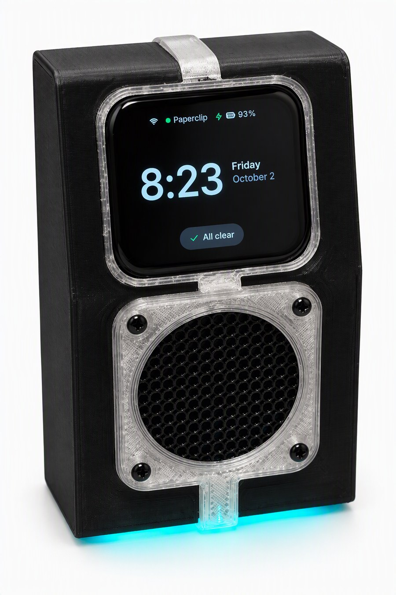

## What it does

- **Alerts from Paperclip:** approvals, failed runs, budget warnings, agent questions, finished tasks and a daily brief. Each has its own colour, light pattern and sound.
- **Approve or reject on the device**, protected by a PIN. Decisions go back to Paperclip as the board user.
- **Agent signature tunes:** each agent's alerts play its own three notes, so you know who's asking before you look.
- **Open on phone:** a QR code takes you straight to the item in Paperclip.
- **Lights:** an LED ring on the board plus a 12-LED underglow around the base. A slow green glow means all is well, amber means something's unreachable, and a sweep confirms an approval.
- **Knock twice** on the desk or the case to silence an alert.
- **Spoken brief and questions** through the built-in speaker.
- **Quiet hours, silence, and a privacy lock** for outside business hours.
- **Set up on the device itself** (Wi-Fi, PIN, pairing), with firmware updates pushed over Wi-Fi by the plugin.
- **Runs on battery or USB.** It shows the battery level and a charging indicator.
- **Demo mode** for showing it off at your desk.

Coming next: a **"Needs you" list**. The device will show everything open in Paperclip that's waiting on you, beyond the notifications, with an LED per item in the base.

## Screens

| | | | |
|:-:|:-:|:-:|:-:|
| 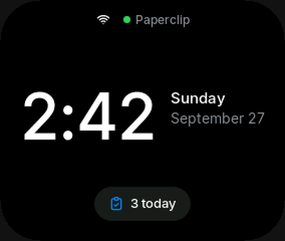 | 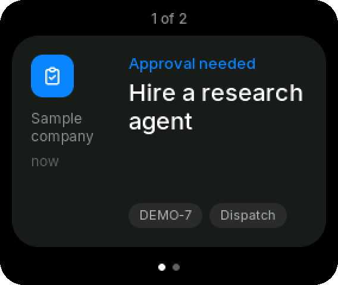 | 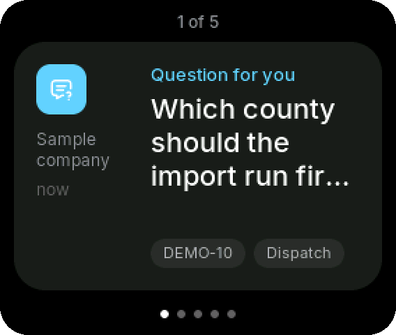 | 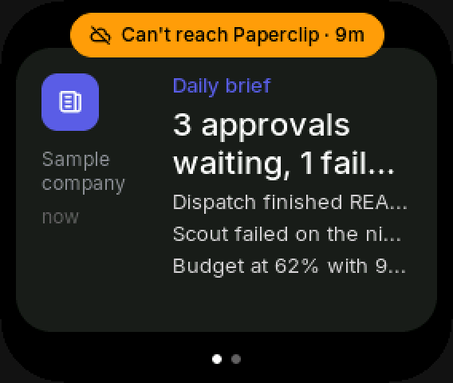 |
| Home | Approval | Agent question | Daily brief |
| 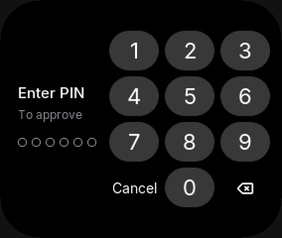 | 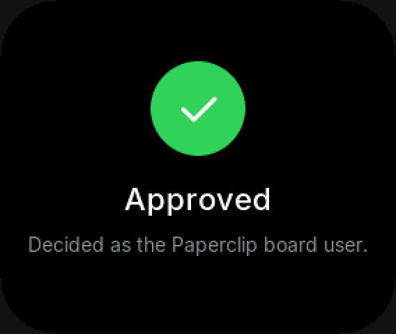 | 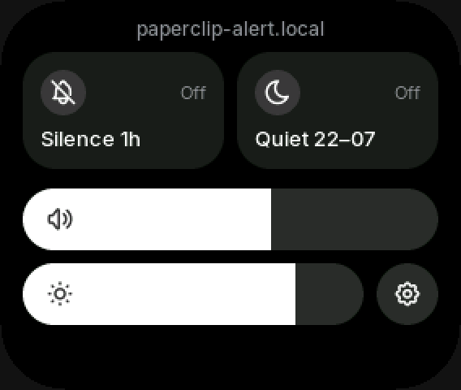 | 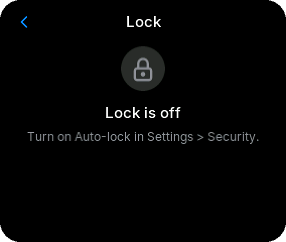 |
| PIN to approve | Approved | Controls | Privacy lock |

## Hardware

- [WaveShare ESP32-S3-AUDIO-Board](https://www.waveshare.com/) (round, with microphones, audio codec and an LED ring)
- WaveShare 1.83" touch LCD, mounted landscape on a 60° face
- 40 mm, 4 Ω speaker in a sealed chamber, front-firing
- 503060 LiPo cell
- WS2812 LED strip (12 LEDs) for the underglow
- 3D-printed housing (PLA+ or PETG), printed without supports, with a clear floor that diffuses the underglow

The housing is fully parametric: a script rebuilds every part in SolidWorks from one set of dimensions. STL files will ship with the release.

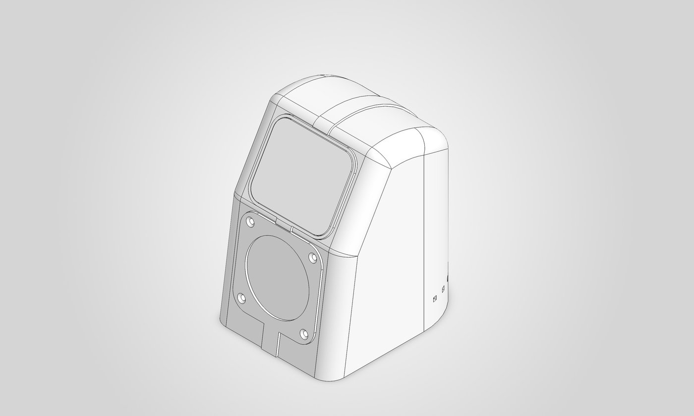

| | | |
|:-:|:-:|:-:|
| 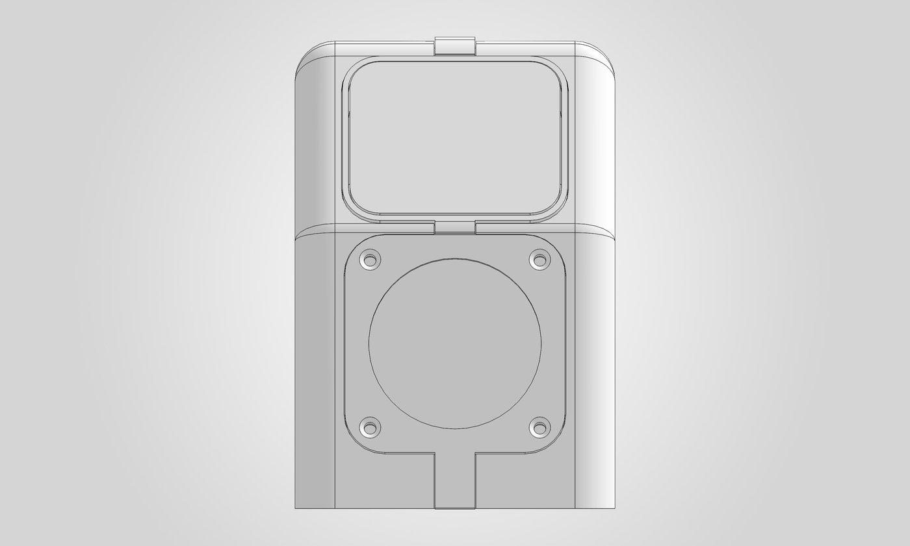 | 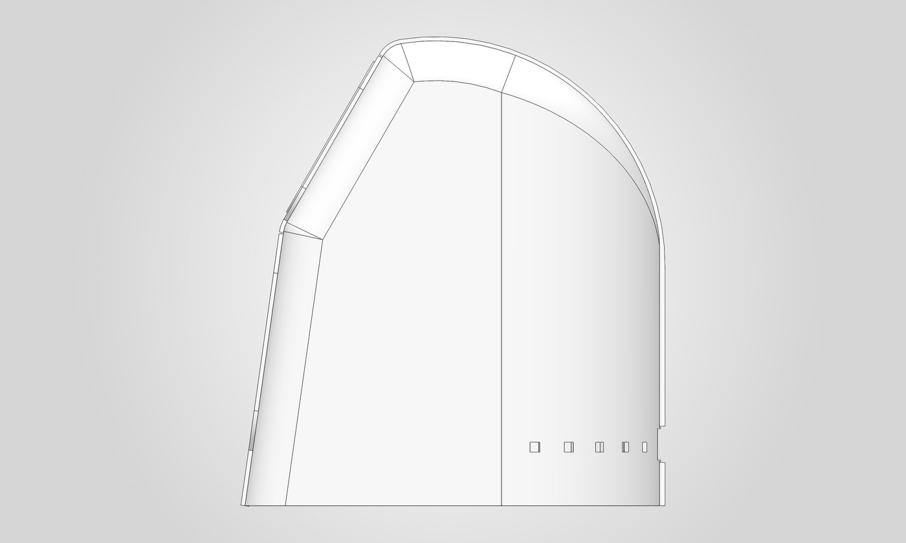 | 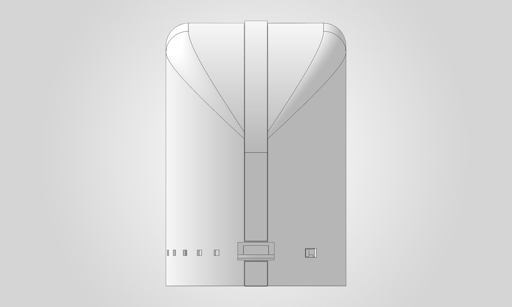 |
| Front | Side | Back |
| 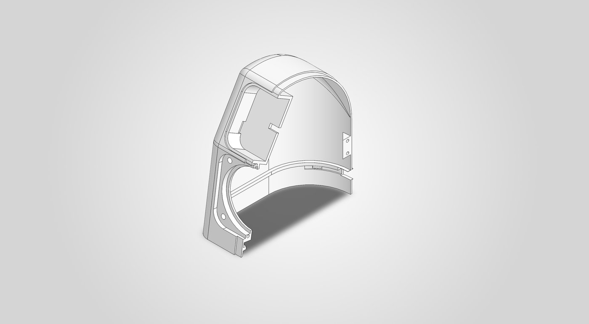 | 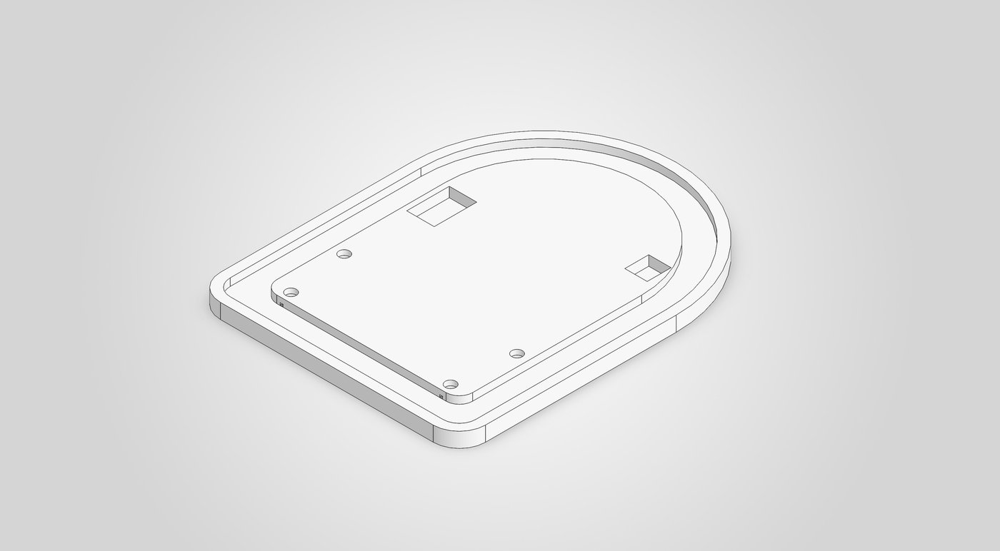 | 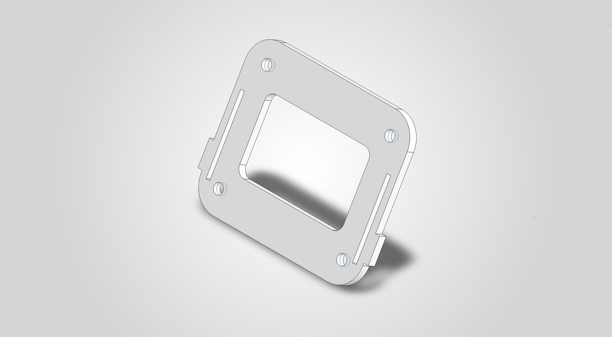 |
| Shell half | Clear floor with the LED channel | Screen caddy |

## How it fits together

- **Firmware** (Arduino, LVGL): the touch UI, sound, lights, battery and power sensing, a local setup page, and signed communication with the plugin.
- **Paperclip plugin**: watches your Paperclip companies and pushes alerts to paired devices. It carries out device decisions through Paperclip's plugin API, and serves firmware updates.

The plugin uses only Paperclip's public plugin API, so it keeps working across Paperclip updates and installs without extra setup.

## Status

Pre-release. Code, build instructions and the setup guide will be published with v1.
